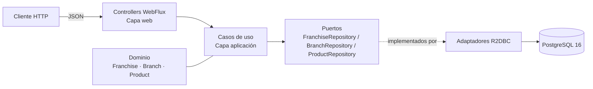
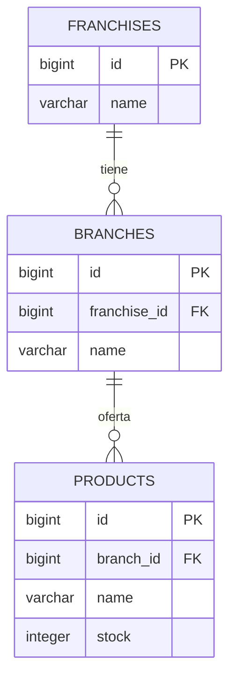
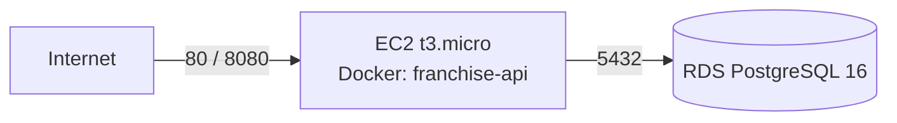

# Franchise API

API reactiva para la gestión de **franquicias, sucursales y productos**, desarrollada con **Spring Boot 4 + WebFlux + R2DBC + PostgreSQL**.

Cada franquicia se compone de un nombre y una lista de sucursales; cada sucursal tiene un nombre y un listado de productos; y cada producto se compone de un nombre y una cantidad de stock.

Repositorio: <https://github.com/AndresFelipeDiazG/franchise-api>

---

## Tabla de contenido

1. [Características](#características)
2. [Stack tecnológico](#stack-tecnológico)
3. [Arquitectura](#arquitectura)
4. [Modelo de datos](#modelo-de-datos)
5. [Estructura del proyecto](#estructura-del-proyecto)
6. [Requisitos previos](#requisitos-previos)
7. [Despliegue en entorno local](#despliegue-en-entorno-local)
8. [Variables de entorno](#variables-de-entorno)
9. [Referencia de la API](#referencia-de-la-api)
10. [Manejo de errores](#manejo-de-errores)
11. [Pruebas automatizadas](#pruebas-automatizadas)
12. [Colección Postman](#colección-postman)
13. [Despliegue en AWS con Terraform](#despliegue-en-aws-con-terraform)
14. [Solución de problemas](#solución-de-problemas)
15. [Flujo de trabajo con Git](#flujo-de-trabajo-con-git)
16. [Decisiones técnicas](#decisiones-técnicas)
17. [Mejoras futuras](#mejoras-futuras)

---

## Características

Cumplimiento de los criterios de aceptación de la prueba:

| # | Criterio | Implementación |
|---|----------|----------------|
| 1 | Proyecto en Spring Boot | Spring Boot 4.1.2 / Java 21 |
| 2 | Agregar una nueva franquicia | `POST /api/franchises` |
| 3 | Agregar una sucursal a una franquicia | `POST /api/franchises/{franchiseId}/branches` |
| 4 | Agregar un producto a una sucursal | `POST /api/branches/{branchId}/products` |
| 5 | Eliminar un producto de una sucursal | `DELETE /api/products/{productId}` |
| 6 | Modificar el stock de un producto | `PATCH /api/products/{productId}/stock` |
| 7 | Producto con mayor stock por sucursal de una franquicia | `GET /api/franchises/{franchiseId}/top-products` |
| 8 | Persistencia de datos | PostgreSQL 16 (local con Docker, AWS RDS en la nube) |
| Extra | Empaquetado con Docker | `Dockerfile` multi-stage + `docker-compose.yml` |
| Extra | Programación reactiva / funcional | WebFlux, Reactor (`Mono` / `Flux`), R2DBC |
| Extra | Actualizar nombre de franquicia | `PATCH /api/franchises/{franchiseId}/name` |
| Extra | Actualizar nombre de sucursal | `PATCH /api/branches/{branchId}/name` |
| Extra | Actualizar nombre de producto | `PATCH /api/products/{productId}/name` |
| Extra | Infraestructura como código | Terraform (EC2 + RDS PostgreSQL en AWS) |
| Extra | Despliegue en la nube | EC2 ejecutando el contenedor + RDS PostgreSQL |

---

## Stack tecnológico

| Componente | Versión / Tecnología |
|------------|----------------------|
| Lenguaje | Java 21 |
| Framework | Spring Boot 4.1.2 |
| API | Spring WebFlux (reactiva, no bloqueante) |
| Persistencia | Spring Data R2DBC + `r2dbc-postgresql` + pool de conexiones |
| Base de datos | PostgreSQL 16 |
| Migraciones | Flyway (`flyway-core`, `flyway-database-postgresql`) |
| Validación | Jakarta Bean Validation |
| Observabilidad | Spring Boot Actuator (`health`, `info`) |
| Pruebas | JUnit 5, Mockito, Reactor Test, Testcontainers |
| Contenedores | Docker, Docker Compose |
| IaC | Terraform 1.5+ (provider AWS ~> 5.0) |
| Build | Maven (wrapper incluido: `mvnw` / `mvnw.cmd`) |

---

## Arquitectura

Se aplica **arquitectura hexagonal (puertos y adaptadores)** combinada con un enfoque reactivo. El dominio no conoce frameworks ni detalles de infraestructura:

- `domain`: modelos inmutables (`record`), puertos (interfaces de repositorio) y excepciones de negocio.
- `application`: casos de uso, un bean por operación de negocio.
- `infrastructure`: adaptadores de entrada (`web`: controllers, DTOs, manejo de errores) y de salida (`adapter`, `entity`, `repository` sobre R2DBC), además de la configuración de beans.



El flujo de una petición es: **Controller → UseCase → Puerto → Adaptador → PostgreSQL**, todo encadenado con `Mono`/`Flux` sin bloquear hilos.

---

## Modelo de datos



Reglas principales (aplicadas en el dominio y reforzadas en la base de datos):

- `name` es obligatorio y no puede estar vacío ni contener solo espacios (`CHECK LENGTH(TRIM(name)) > 0`).
- `stock` no puede ser nulo ni negativo (`CHECK stock >= 0`, `DEFAULT 0`).
- Borrado en cascada: al eliminar una franquicia se eliminan sus sucursales y productos; al eliminar una sucursal, sus productos.
- Índices: `idx_branches_franchise_id` y `idx_products_branch_stock (branch_id, stock DESC)` para optimizar la consulta de mayor stock.

El esquema se crea automáticamente con Flyway al iniciar la aplicación:

```
src/main/resources/db/migration/V1__create_initial_schema.sql
```

---

## Estructura del proyecto

```
franchise-api/
├── src/
│   ├── main/
│   │   ├── java/com/accenture/franchise_api/
│   │   │   ├── FranchiseApiApplication.java
│   │   │   ├── domain/
│   │   │   │   ├── model/            # Franchise, Branch, Product, BranchTopProduct
│   │   │   │   ├── port/             # Interfaces de repositorio
│   │   │   │   └── exceptions/       # DomainValidationException, ResourceNotFoundException
│   │   │   ├── application/useCase/  # 9 casos de uso
│   │   │   └── infrastructure/
│   │   │       ├── web/              # Controllers, DTOs, GlobalExceptionHandler
│   │   │       ├── adapter/          # Adaptadores R2DBC de los puertos
│   │   │       ├── entity/           # Entidades de persistencia
│   │   │       ├── repository/       # Repositorios Spring Data R2DBC
│   │   │       └── config/           # BeanConfiguration (inyección de casos de uso)
│   │   └── resources/
│   │       ├── application.yml
│   │       └── db/migration/V1__create_initial_schema.sql
│   └── test/java/...                 # Pruebas unitarias y Testcontainers
├── terraform/                        # Infraestructura como código (AWS EC2 + RDS)
├── Dockerfile
├── docker-compose.yml
├── Franchise-api.postman_collection.json
├── .env.example
└── pom.xml
```

---

## Requisitos previos

| Herramienta | Versión mínima | Obligatorio |
|-------------|----------------|-------------|
| JDK | 21 | Sí (para ejecución local sin Docker) |
| Docker Desktop / Docker Engine + Compose | 24+ | Sí (para la opción con contenedores y para los tests) |
| Maven | 3.9+ | No (se incluye el wrapper `mvnw`) |
| Terraform | 1.5+ | Solo para desplegar en AWS |
| AWS CLI + cuenta AWS | — | Solo para desplegar en AWS |
| Postman (opcional) | — | Para probar la API con la colección incluida |

Verifica tu entorno:

```bash
java -version        # debe reportar 21.x
docker --version
docker compose version
```

---

## Despliegue en entorno local

### Opción A — Todo con Docker Compose (recomendado)

Levanta PostgreSQL y la API en un solo paso; no requiere Java ni Maven instalados.

```bash
# 1. Ubicarse en la raíz del proyecto
cd franchise-api

# 2. Crear el archivo de variables de entorno (opcional, hay valores por defecto)
cp .env.example .env

# 3. Construir y levantar los servicios
docker compose up --build -d
```

> En Windows PowerShell el equivalente a `cp` es `Copy-Item .env.example .env`.

Esto crea:

| Servicio | Contenedor | Puerto host |
|----------|------------|-------------|
| PostgreSQL 16 | `franchise-postgres` | `5432` (configurable con `DB_PORT`) |
| API | `franchise-api` | `8080` (configurable con `SERVER_PORT`) |

La API espera a que PostgreSQL esté saludable (`depends_on: condition: service_healthy`) y Flyway aplica las migraciones al arrancar.

Verificar que todo quedó arriba:

```bash
docker compose ps
curl http://localhost:8080/actuator/health
```

Respuesta esperada:

```json
{"status":"UP","groups":["liveness","readiness"]}
```

Comandos útiles:

```bash
docker compose logs -f api        # ver logs de la API
docker compose logs -f postgres   # ver logs de la base de datos
docker compose down               # detener y eliminar contenedores
docker compose down -v            # detener y borrar también los datos (volumen)
docker compose up --build -d       # reconstruir la imagen tras cambios de código
```

### Opción B — Base de datos en Docker + API con Maven (desarrollo)

Útil para iterar con recarga rápida y depuración desde el IDE.

```bash
# 1. Levantar únicamente PostgreSQL
docker compose up -d postgres

# 2. Ejecutar la API (Linux / macOS / Git Bash)
./mvnw spring-boot:run

# 2. Ejecutar la API (Windows, CMD o PowerShell)
.\mvnw.cmd spring-boot:run
```

La aplicación toma por defecto `localhost:5432`, base de datos `franchise`, usuario `franchise` y contraseña `franchise`, por lo que no necesitas configurar nada si usas el `docker-compose.yml` incluido.

También puedes generar el JAR ejecutable y correrlo directamente:

```bash
./mvnw clean package -DskipTests
java -jar target/franchise-api-0.0.1-SNAPSHOT.jar
```

### Opción C — Desde el IDE

1. Levanta la base de datos con `docker compose up -d postgres`.
2. Importa el proyecto como proyecto Maven en IntelliJ IDEA / Eclipse / VS Code.
3. Ejecuta la clase `com.accenture.franchise_api.FranchiseApiApplication`.
4. (Opcional) Ejecuta `TestFranchiseApiApplication` para arrancar la aplicación con una base de datos efímera provista por Testcontainers.

### Verificación rápida del despliegue

```bash
curl -i http://localhost:8080/actuator/health
curl -i -X POST http://localhost:8080/api/franchises \
  -H "Content-Type: application/json" \
  -d '{"name":"Franquicia Centro"}'
```

Si recibes `201 Created` con `{"id":1,"name":"Franquicia Centro"}`, el despliegue local está funcionando.

---

## Variables de entorno

La aplicación se configura mediante variables de entorno con valores por defecto (ver `src/main/resources/application.yml` y `.env.example`).

| Variable | Valor por defecto | Descripción |
|----------|-------------------|-------------|
| `DB_HOST` | `localhost` | **Host** de PostgreSQL (`localhost` en local, `postgres` dentro de Compose, el endpoint de RDS en AWS). No incluir esquema ni URL. |
| `DB_PORT` | `5432` | Puerto de PostgreSQL |
| `DB_NAME` | `franchise` | Nombre de la base de datos |
| `DB_USER` | `franchise` | Usuario de la base de datos |
| `DB_PASSWORD` | `franchise` | Contraseña de la base de datos |
| `DB_SSL_MODE` | `disable` | Modo SSL de R2DBC/JDBC (`require` para RDS con SSL) |
| `SERVER_PORT` | `8080` | Solo en Docker Compose: puerto publicado en el host |

Ejemplo de `.env` para Docker Compose:

```properties
DB_NAME=franchise
DB_USER=franchise
DB_PASSWORD=franchise
DB_PORT=5432
SERVER_PORT=8080
```

> **Nota:** `application.yml` construye las URLs a partir de estas variables:
> `r2dbc:postgresql://${DB_HOST}:${DB_PORT}/${DB_NAME}` para R2DBC y `jdbc:postgresql://...` para Flyway.
> Por eso `DB_HOST` debe contener únicamente el host. El archivo `.env` está excluido del repositorio por `.gitignore`; usa `.env.example` como plantilla.

---

## Referencia de la API

URL base local: `http://localhost:8080`

| Método | Ruta | Descripción | Código de éxito |
|--------|------|-------------|-----------------|
| `POST` | `/api/franchises` | Crear franquicia | `201` |
| `PATCH` | `/api/franchises/{franchiseId}/name` | Actualizar nombre de franquicia | `200` |
| `POST` | `/api/franchises/{franchiseId}/branches` | Agregar sucursal a una franquicia | `201` |
| `PATCH` | `/api/branches/{branchId}/name` | Actualizar nombre de sucursal | `200` |
| `POST` | `/api/branches/{branchId}/products` | Agregar producto a una sucursal | `201` |
| `PATCH` | `/api/products/{productId}/name` | Actualizar nombre de producto | `200` |
| `PATCH` | `/api/products/{productId}/stock` | Actualizar stock de producto | `200` |
| `DELETE` | `/api/products/{productId}` | Eliminar producto de una sucursal | `204` |
| `GET` | `/api/franchises/{franchiseId}/top-products` | Producto con mayor stock por sucursal de la franquicia | `200` |
| `GET` | `/actuator/health` | Estado de salud del servicio | `200` |
| `GET` | `/actuator/info` | Información del servicio | `200` |

### 1. Crear franquicia

```bash
curl -X POST http://localhost:8080/api/franchises \
  -H "Content-Type: application/json" \
  -d '{"name":"Franquicia Centro"}'
```

```json
{ "id": 1, "name": "Franquicia Centro" }
```

### 2. Actualizar nombre de franquicia

```bash
curl -X PATCH http://localhost:8080/api/franchises/1/name \
  -H "Content-Type: application/json" \
  -d '{"name":"Franquicia Centro Actualizada"}'
```

```json
{ "id": 1, "name": "Franquicia Centro Actualizada" }
```

### 3. Agregar sucursal a una franquicia

```bash
curl -X POST http://localhost:8080/api/franchises/1/branches \
  -H "Content-Type: application/json" \
  -d '{"name":"Sucursal Norte"}'
```

```json
{ "id": 1, "franchiseId": 1, "name": "Sucursal Norte" }
```

### 4. Actualizar nombre de sucursal

```bash
curl -X PATCH http://localhost:8080/api/branches/1/name \
  -H "Content-Type: application/json" \
  -d '{"name":"Sucursal Norte Actualizada"}'
```

```json
{ "id": 1, "franchiseId": 1, "name": "Sucursal Norte Actualizada" }
```

### 5. Agregar producto a una sucursal

```bash
curl -X POST http://localhost:8080/api/branches/1/products \
  -H "Content-Type: application/json" \
  -d '{"name":"Arroz","stock":50}'
```

```json
{ "id": 1, "branchId": 1, "name": "Arroz", "stock": 50 }
```

### 6. Actualizar nombre de producto

```bash
curl -X PATCH http://localhost:8080/api/products/1/name \
  -H "Content-Type: application/json" \
  -d '{"name":"Arroz Premium"}'
```

```json
{ "id": 1, "branchId": 1, "name": "Arroz Premium", "stock": 50 }
```

### 7. Actualizar stock de producto

```bash
curl -X PATCH http://localhost:8080/api/products/1/stock \
  -H "Content-Type: application/json" \
  -d '{"stock":21}'
```

```json
{ "id": 1, "branchId": 1, "name": "Arroz Premium", "stock": 21 }
```

### 8. Eliminar producto de una sucursal

```bash
curl -i -X DELETE http://localhost:8080/api/products/1
```

Respuesta: `204 No Content`. Si el producto no existe, retorna `404 Not Found`.

### 9. Producto con mayor stock por sucursal

Devuelve, por cada sucursal de la franquicia, el producto con mayor stock. Si hay empate, se toma el de menor `id`. Las sucursales sin productos no aparecen en el resultado.

```bash
curl http://localhost:8080/api/franchises/1/top-products
```

```json
[
  {
    "branchId": 1,
    "branchName": "Sucursal Norte Actualizada",
    "productId": 1,
    "productName": "Arroz Premium",
    "stock": 21
  }
]
```

La consulta se resuelve en una sola sentencia SQL (`SELECT DISTINCT ON (b.id) ... ORDER BY b.id ASC, p.stock DESC, p.id ASC`) apoyada en los índices de la migración.

### Flujo completo de prueba

```bash
# 1. Franquicia
curl -s -X POST http://localhost:8080/api/franchises \
  -H "Content-Type: application/json" -d '{"name":"Franquicia Centro"}'

# 2. Sucursal
curl -s -X POST http://localhost:8080/api/franchises/1/branches \
  -H "Content-Type: application/json" -d '{"name":"Sucursal Norte"}'

# 3. Productos
curl -s -X POST http://localhost:8080/api/branches/1/products \
  -H "Content-Type: application/json" -d '{"name":"Arroz","stock":50}'
curl -s -X POST http://localhost:8080/api/branches/1/products \
  -H "Content-Type: application/json" -d '{"name":"Café","stock":80}'

# 4. Producto con más stock por sucursal (debe listar Café con 80)
curl -s http://localhost:8080/api/franchises/1/top-products
```

---

## Manejo de errores

Todas las excepciones se centralizan en `GlobalExceptionHandler`, que responde con el siguiente formato:

```json
{
  "timeStamp": "2026-11-13T10:15:30.123",
  "status": 404,
  "error": "Not Found",
  "message": "Franquicia no encontrada con ID: 99",
  "details": []
}
```

| Situación | Código HTTP | `error` |
|-----------|-------------|---------|
| Recurso inexistente (franquicia, sucursal o producto) | `404` | `Not Found` |
| Body inválido (`name` vacío, `stock` nulo o negativo, JSON malformado) | `400` | `Validation Error` / `Bad Request` |
| Regla de dominio incumplida | `400` | `Bad Request` |
| Error inesperado | `500` | `Internal Server Error` |

Ejemplo de error de validación:

```json
{
  "timeStamp": "2026-11-13T10:16:02.004",
  "status": 400,
  "error": "Validation Error",
  "message": "Los datos enviados en la petición no son válidos",
  "details": ["stock; El stock no puede ser negativo"]
}
```

---

## Pruebas automatizadas

```bash
# Todas las pruebas (Linux / macOS / Git Bash)
./mvnw test

# Todas las pruebas (Windows)
.\mvnw.cmd test

# Solo una clase
.\mvnw.cmd test -Dtest=AddProductToBranchUseCaseTest
```

> **Importante:** las pruebas requieren **Docker en ejecución**, porque `TestcontainersConfiguration` levanta un contenedor `postgres:16-alpine` y lo inyecta con `@ServiceConnection`. El primer test puede tardar más mientras descarga la imagen.

Cobertura de las pruebas incluidas:

| Tipo | Clases |
|------|--------|
| Dominio | `FranchiseTest`, `BranchTest`, `ProductTest` |
| Casos de uso | `CreateFranchiseUseCaseTest`, `UpdateFranchiseNameUseCaseTest`, `AddBranchToFranchiseUseCaseTest`, `UpdateBranchNameUseCaseTest`, `AddProductToBranchUseCaseTest`, `UpdateProducNameUseCaseTest`, `UpdateProductStockUseCaseTest`, `DeleteProductFromBranchUseCaseTest`, `GetTopProductsByBranchUseCaseTest` |
| Integración | `FranchiseApiApplicationTests` (contexto completo + PostgreSQL real en Testcontainers) |

También es posible arrancar la aplicación contra un PostgreSQL efímero (sin Docker Compose) ejecutando `TestFranchiseApiApplication`.

---

## Colección Postman

El archivo `Franchise-api.postman_collection.json` incluye las peticiones de franquicias, sucursales y productos.

1. Importar el archivo en Postman (*Import → File*).
2. La variable de colección `baseUrl` ya viene precargada con `http://localhost:8080`; ajústala si despliegas en otro host.
3. Ejecutar las peticiones en orden y completar `franchiseId`, `branchId` y `productId` con los identificadores devueltos.

---

## Despliegue en AWS con Terraform

La carpeta `terraform/` aprovisiona la solución completa en AWS:

- **EC2** (`t3.micro`, Amazon Linux 2023) que ejecuta el contenedor Docker de la API en los puertos `80` y `8080`.
- **RDS PostgreSQL 16** (`db.t4g.micro`, 20 GB, no accesible públicamente).
- **Security Groups**: la API expone `80`, `8080` y `22`; RDS solo acepta `5432` desde el security group de la API.
- **Subnet group** y **parameter group** (`rds.force_ssl = 0`) para RDS.



### 1. Publicar la imagen en Docker Hub

```bash
docker build -t <tuusuario>/franchise-api:1.0.0 .
docker push <tuusuario>/franchise-api:1.0.0
```

### 2. Configurar credenciales de AWS

```bash
aws configure            # o exportar AWS_ACCESS_KEY_ID / AWS_SECRET_ACCESS_KEY
```

### 3. Definir las variables de Terraform

```bash
cd terraform
cp tfvars.example terraform.tfvars
```

Editar `terraform.tfvars`:

```hcl
aws_region   = "us-east-1"
db_name      = "franchise"
db_username  = "franchise"
db_password  = "UnaClaveSeguraDeMasDe8Caracteres"
docker_image = "<tuusuario>/franchise-api:1.0.0"
```

> `terraform.tfvars` está excluido de Git por contener credenciales. `terraform.tfvars`/`*.tfstate` no deben versionarse.

### 4. Aprovisionar

```bash
terraform init
terraform plan
terraform apply
```

### 5. Obtener las salidas

```bash
terraform output
```

| Output | Descripción |
|--------|-------------|
| `api_public_url` | URL pública de la API (`http://<ip-publica>`) |
| `health_check_url` | `http://<ip-publica>/actuator/health` |
| `rds_endpoint` | Host de conexión de PostgreSQL en RDS |

La API queda disponible en `http://<ip-publica>/api/...` (puerto 80 redirigido al 8080 del contenedor).

### 6. Destruir la infraestructura

```bash
terraform destroy
```

> **Consideraciones:** el `user_data` de la instancia descarga la imagen del repositorio público de Docker Hub, por lo que la imagen debe existir antes del `apply`; si cambias la imagen después, debes recrear la instancia (`terraform apply -replace=aws_instance.api_server`). La instancia se crea en la VPC y subredes por defecto de la cuenta.

---

## Solución de problemas

| Síntoma | Causa probable | Solución |
|---------|----------------|----------|
| `Connection refused` a PostgreSQL al arrancar | La base de datos no está lista | `docker compose up -d postgres` y esperar el *healthcheck*; revisar `docker compose ps` |
| `Port 8080 is already in use` | Otro proceso usa el puerto | Detener ese proceso o usar `SERVER_PORT=8081 docker compose up -d` |
| `Port 5432 is already in use` | Ya existe un PostgreSQL local | Cambiar `DB_PORT` en `.env` (por ejemplo `5433`) y actualizar `DB_PORT` para la API |
| `Unable to obtain connection from database` con host extraño | `DB_HOST` contiene una URL completa en lugar del host | Usar `DB_HOST=localhost` (o `postgres` dentro de Compose) |
| Flyway falla con *checksum mismatch* | Se modificó una migración ya aplicada | Restaurar el archivo o recrear la base (`docker compose down -v`) |
| Los tests fallan al iniciar Testcontainers | Docker no está corriendo | Iniciar Docker Desktop y reintentar |
| `401/403` al usar Terraform | Credenciales AWS ausentes o sin permisos | Revisar `aws configure` y los permisos de EC2/RDS |
| La API en AWS responde `502`/no responde | La imagen no existe o el contenedor no arrancó | Conectarse por SSH y revisar `docker logs franchise-api` |

---

## Flujo de trabajo con Git

El repositorio usa ramas por funcionalidad y **Conventional Commits**:

```
main
├── feat/infrastructure-persistence
├── feat/infrastructure-web
└── feat/aws-terraform-deployment
```

Historial representativo:

```
feat(infra): agregar configuración de Terraform para despliegue en AWS EC2 y RDS PostgreSQL con SSL
feat(api): implementar endpoints reactivos para gestión de franquicias, sucursales y productos
feat(web): implementar controladores reactivos webflux, DTOs y manejo global de excepciones
feat(persistence): implementar entidades, repositorio y adaptadores R2DBC
feat(application): implementar casos de uso reactivos y pruebas unitarias
feat(domain): add immutable domain models, ports, exceptions and unit tests
chore: configure r2dbc, flyway migration and testcontainers postgresql
```

Convención de ramas: `feat/<alcance>`, `fix/<alcance>`, `chore/<alcance>`; los mensajes siguen el patrón `tipo(alcance): descripción`.

---

## Decisiones técnicas

- **Spring WebFlux + R2DBC** en lugar de MVC + JPA: cumple el plus de programación reactiva y evita bloqueos de hilo en cada consulta.
- **Arquitectura hexagonal**: el dominio y los casos de uso son independientes del framework y de la base de datos, lo que facilita las pruebas unitarias con mocks de los puertos.
- **Flyway** para versionar el esquema, de modo que cualquier entorno (local, CI, AWS) quede igual con solo arrancar la aplicación.
- **`SELECT DISTINCT ON`** de PostgreSQL para resolver el top de productos por sucursal en una sola consulta eficiente.
- **Docker multi-stage** (`maven` → `jre-alpine`) para una imagen final ligera que no incluye el JDK ni las dependencias de build.
- **Testcontainers** para pruebas de integración contra un PostgreSQL real y efímero, sin depender de una base preinstalada.
- **Terraform** para reproducir la infraestructura (EC2 + RDS) y cumplir el plus de IaC y despliegue en la nube.

---

## Mejoras futuras

- Paginación y filtros de búsqueda en los listados.
- Documentación OpenAPI/Swagger (`springdoc-openapi`).
- Autenticación y autorización (por ejemplo, OAuth2/JWT).
- Pipeline CI/CD (GitHub Actions) con build, tests y publicación de imagen.
- Pruebas de integración de los controladores con `WebTestClient`.
- Endurecer la infraestructura: RDS con SSL obligatorio, SSH restringido por IP, secretos en AWS Secrets Manager.
